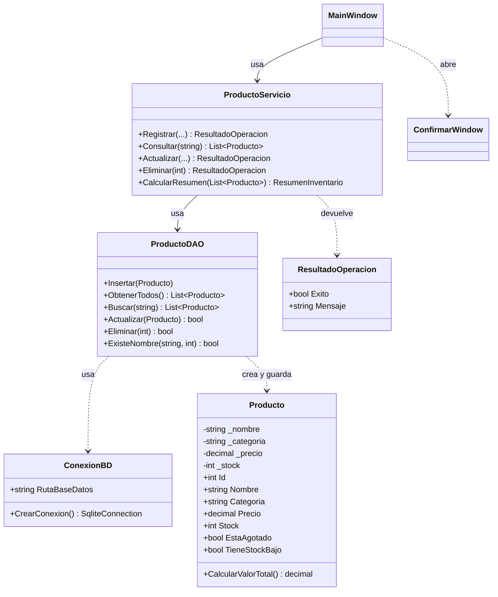

# StockMaster – Sistema de inventario

Aplicación de escritorio para administrar los productos de una pequeña tienda.
Proyecto del **Parcial Final – Programación con C# y .NET**.

## 1. Información general

| | |
|---|---|
| **Proyecto** | StockMaster – Sistema de inventario |
| **Estudiante** | _[Escribe aquí tu nombre completo]_ |
| **Asignatura** | Programación con C# y .NET |

**Descripción.** StockMaster permite llevar el control de los productos de una tienda: cuánto cuestan, a qué categoría pertenecen y cuántas unidades quedan.

**Problema que resuelve.** Muchas tiendas pequeñas llevan el inventario en cuadernos o de memoria, lo que genera errores, productos agotados sin notarlo y pérdida de información. StockMaster guarda todo en una base de datos y avisa visualmente cuando un producto tiene poco stock.

**Objetivo principal.** Ofrecer una herramienta sencilla para registrar, consultar, modificar y eliminar productos, conservando la información aunque se cierre el programa.

## 2. Funcionalidades

- **Registrar** productos (nombre, categoría, precio y stock).
- **Consultar** todos los productos en una tabla, con ordenamiento por columnas.
- **Buscar** en tiempo real por nombre o categoría.
- **Editar** un producto: al hacer clic en una fila, sus datos pasan al formulario.
- **Eliminar** un producto, con ventana de confirmación.
- **Validaciones** con mensajes claros (campos vacíos, precio no numérico, stock negativo, nombre repetido…). El programa no se cierra por errores del usuario.
- **Resumen** superior: total de productos, unidades en stock, valor del inventario y cantidad de productos con stock bajo o agotado.
- **Estado de stock** por colores: Disponible (verde), Stock bajo (≤ 5 unidades, amarillo) y Agotado (0 unidades, rojo).
- **Persistencia**: los datos se guardan en SQLite y siguen ahí al reabrir la aplicación.

## 3. Tecnologías utilizadas

| Tecnología | Uso |
|---|---|
| **C#** | Lenguaje de programación |
| **.NET 8** (`net8.0`) | Plataforma. Se puede compilar con el SDK 8.0 o uno más nuevo |
| **Avalonia UI 11.2.3** | Interfaz gráfica de escritorio (archivos `.axaml`) |
| **Avalonia.Controls.DataGrid** | Tabla de productos |
| **ADO.NET** | Acceso a datos con comandos SQL parametrizados |
| **SQLite** | Base de datos local (un solo archivo) |
| **Microsoft.Data.Sqlite 8.0.11** | Proveedor ADO.NET para SQLite |

No se usa Entity Framework ni ningún otro ORM.

## 4. Estructura del proyecto

```
StockMaster/
├── StockMaster.csproj        # Configuración del proyecto y paquetes NuGet
├── Program.cs                # Punto de entrada: arranca Avalonia
├── App.axaml / App.axaml.cs  # Aplicación, estilos globales y arranque
├── Models/                   # Clases que representan datos
│   ├── Producto.cs
│   └── ResumenInventario.cs
├── Data/                     # Acceso a la base de datos (ADO.NET)
│   ├── ConexionBD.cs
│   ├── InicializadorBD.cs
│   └── ProductoDAO.cs
├── Services/                 # Lógica del programa y validaciones
│   ├── ProductoServicio.cs
│   └── ResultadoOperacion.cs
├── Views/                    # Interfaz gráfica (Avalonia)
│   ├── MainWindow.axaml / .axaml.cs
│   └── ConfirmarWindow.axaml / .axaml.cs
├── Database/
│   └── schema.sql            # Script SQL de referencia
├── evidencias/               # Capturas de las pruebas
├── docs/
│   └── GUIA_EXPLICACION.md   # Guía para explicar el proyecto
└── README.md
```

### Clases principales y responsabilidades

| Clase | Capa | Responsabilidad |
|---|---|---|
| `Producto` | Modelo | Representa un producto. Valida sus propios datos (encapsulamiento). |
| `ResumenInventario` | Modelo | Lleva los totales que se muestran en las tarjetas. |
| `ConexionBD` | Datos | Define dónde está el archivo `.db` y crea conexiones. |
| `InicializadorBD` | Datos | Crea la tabla `Productos` si no existe. |
| `ProductoDAO` | Datos | Realiza el CRUD con ADO.NET. Es la única clase que ejecuta SQL. |
| `ProductoServicio` | Lógica | Convierte y valida los datos, aplica reglas (nombre único) y llama al DAO. |
| `ResultadoOperacion` | Lógica | Informa a la interfaz si algo salió bien y con qué mensaje. |
| `MainWindow` | Interfaz | Ventana principal: eventos de botones, tabla y formulario. |
| `ConfirmarWindow` | Interfaz | Diálogo de confirmación antes de eliminar. |

### Flujo de una operación (ejemplo: botón Guardar)

```
MainWindow (lee las cajas de texto)
   → ProductoServicio.Registrar(...)   convierte, valida y revisa reglas
      → ProductoDAO.Insertar(...)      ejecuta el INSERT con ADO.NET
         → SQLite (archivo stockmaster.db)
   ← ResultadoOperacion (Exito + Mensaje)
MainWindow muestra el mensaje y refresca la tabla
```

### Diagrama de clases (UML)



### Dónde se aplica la POO

- **Clases y objetos:** `Producto`, `ProductoDAO`, `ProductoServicio`, `MainWindow`, etc.
- **Propiedades y constructores:** `Producto` tiene dos constructores (producto nuevo y producto ya guardado).
- **Encapsulamiento:** los campos de `Producto` son privados; solo se modifican mediante propiedades que validan (por ejemplo, el precio debe ser mayor que 0). `ResultadoOperacion` tiene constructor privado y se crea con `Ok()` o `Error()`.
- **Métodos:** `CalcularValorTotal()`, `Registrar()`, `Insertar()`, etc.
- **Separación de responsabilidades:** interfaz (`Views`), lógica (`Services`) y acceso a datos (`Data`) están en carpetas y clases distintas.
- **Herencia:** `MainWindow` y `ConfirmarWindow` heredan de `Window`; `App` hereda de `Application` (Avalonia).
- **No se usaron** interfaces ni polimorfismo propios porque el proyecto tiene una sola entidad y no se justificaba.

## 5. Instalación de dependencias

1. Instala el **SDK de .NET 8.0 o superior**: <https://dotnet.microsoft.com/download>
   Verifica con:
   ```bash
   dotnet --version
   ```
2. Descarga el código desde GitHub:
   ```bash
   git clone <URL-DEL-REPOSITORIO>
   cd StockMaster
   ```
   (o descarga el ZIP desde GitHub y descomprímelo).
3. Restaura las dependencias (descarga los paquetes NuGet declarados en `StockMaster.csproj`):
   ```bash
   dotnet restore
   ```

Paquetes que se descargan: `Avalonia`, `Avalonia.Desktop`, `Avalonia.Themes.Fluent`, `Avalonia.Controls.DataGrid` y `Microsoft.Data.Sqlite`. Se necesita conexión a internet la primera vez.

No requiere instalar SQLite aparte ni configurar nada más.

## 6. Ejecución del programa

Desde la carpeta que contiene `StockMaster.csproj`:

```bash
dotnet restore
dotnet run
```

Se abrirá la ventana de StockMaster. Funciona en Windows, Linux y macOS con entorno gráfico.

## 7. Base de datos

**Qué almacena:** los productos de la tienda.

**Tabla `Productos`:**

| Campo | Tipo | Descripción |
|---|---|---|
| `Id` | INTEGER, clave primaria, autoincremental | Identificador único |
| `Nombre` | TEXT, obligatorio | Nombre del producto |
| `Categoria` | TEXT, obligatorio | Categoría |
| `Precio` | REAL, obligatorio, mayor que 0 | Precio unitario |
| `Stock` | INTEGER, obligatorio, mayor o igual a 0 | Unidades disponibles |

**Creación:** la base de datos se genera **automáticamente** la primera vez que se ejecuta el programa (`InicializadorBD.Inicializar()`, llamado desde `App.axaml.cs`). No hay que ejecutar ningún script. El archivo `Database/schema.sql` solo es una copia del SQL como referencia.

**Ubicación del archivo:** `stockmaster.db`, dentro de la carpeta de datos del usuario:
- Windows: `C:\Users\<usuario>\AppData\Local\StockMaster\`
- Linux: `~/.local/share/StockMaster/`
- macOS: `~/Library/Application Support/StockMaster/`

La ruta exacta también aparece en la parte inferior de la ventana. Se guarda ahí (y no junto al programa) para que los datos no se borren al recompilar. Para empezar con datos vacíos basta con borrar ese archivo.

**Conexión con SQLite:** `ConexionBD.CrearConexion()` crea un `SqliteConnection` (ADO.NET) con la cadena `Data Source=<ruta>`.

**Dónde está el CRUD:** todo en `Data/ProductoDAO.cs`:

| Operación | Método | SQL |
|---|---|---|
| Create | `Insertar` | `INSERT INTO` |
| Read | `ObtenerTodos`, `Buscar` | `SELECT` |
| Update | `Actualizar` | `UPDATE` |
| Delete | `Eliminar` | `DELETE` |

Todas las consultas usan **parámetros** (`$nombre`, `$id`…) y cierran la conexión automáticamente con `using`.

## 8. Evidencias de funcionamiento

Las capturas están en la carpeta [`evidencias/`](evidencias/).

> ⚠️ **PENDIENTE:** reemplazar cada fila con la captura real tomada al ejecutar la aplicación, y escribir el resultado obtenido.

| # | Prueba | Qué se hizo | Resultado esperado | Captura |
|---|---|---|---|---|
| 1 | Registro | Agregar un producto | Se guarda y aparece en la tabla | _pendiente:_ `evidencias/01-registro.png` |
| 2 | Consulta | Ver / buscar productos | Se muestran los registros almacenados | _pendiente:_ `evidencias/02-consulta.png` |
| 3 | Actualización | Editar un producto | Los cambios se guardan | _pendiente:_ `evidencias/03-actualizacion.png` |
| 4 | Eliminación | Eliminar un producto | El registro deja de aparecer | _pendiente:_ `evidencias/04-eliminacion.png` |
| 5 | Validación | Enviar datos incorrectos (ej. precio "abc") | Mensaje de error y el programa sigue abierto | _pendiente:_ `evidencias/05-validacion.png` |
| 6 | Persistencia | Cerrar y volver a abrir | Los registros siguen disponibles | _pendiente:_ `evidencias/06-persistencia.png` |

## 9. Problemas encontrados y soluciones

> ⚠️ **PENDIENTE:** completar con al menos una dificultad **real** que hayas tenido al compilar o ejecutar el proyecto, y cómo la resolviste.

_Ejemplo del formato:_
- **Problema:** _(describe el error o la dificultad)_
- **Causa:** _(por qué ocurría)_
- **Solución:** _(qué hiciste para resolverlo)_
